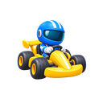

# Sunny Kart · Motion Break

一款为办公间隙设计的休闲体感卡丁车游戏。坐在电脑前，用摄像头识别头部和双肩：**歪头变道、倾肩转弯、耸肩加速**。道路辅助会帮助车辆安全通过弯道，也可以切换到键盘操作。



- 3 条地图：Meadow Cruise、Lakeside Flow、Sunny City Circuit。
- 单人游戏，5 辆伙伴车，3 圈一局，适合几分钟的工作间歇。
- 3D 卡通城市、漂移烟雾、氮气尾焰、尾灯方向反馈和音效。
- 默认 Motion 模式，也支持 Keyboard。游戏界面为英文。
- 摄像头图像在本机识别，不上传、不保存录像；设置和成绩保存在浏览器本地。

## 选择安装方式

| 方式 | 适合谁 | 是否需要 Node.js |
|---|---|---|
| [下载 Chrome 插件](https://github.com/X-mOtion/sunny-kart-motion-break/releases/latest) | 想直接玩 | 不需要 |
| 从源码在本地运行 | 想修改游戏或查看代码 | 需要 |
| 下载网页版构建包 | 想运行已经构建好的网页 | 需要 Node.js 或其他本地 HTTP 服务 |

**完整图文路径和故障处理：[详细安装说明](docs/INSTALL.zh-CN.md)。**

## 最快试玩：安装 Chrome 插件

1. 到 [Releases](https://github.com/X-mOtion/sunny-kart-motion-break/releases/latest)，下载 `SunnyKart-Chrome-extension.zip`。
2. 解压，找到 `SunnyKart-Chrome` 文件夹；里面应直接有 `manifest.json`。
3. 在 Chrome 地址栏输入 `chrome://extensions`，打开右上角 **开发者模式**。
4. 点击 **加载已解压的扩展程序**，选择 `SunnyKart-Chrome` 文件夹。
5. 在工具栏的拼图菜单固定 **Sunny Kart - Motion Break**，点击黄色赛车图标打开游戏。
6. 默认选中 **Motion**。点击 **Let us cruise**，允许摄像头，保持头部与双肩入镜即可开始。

插件包含素材和识别模型，安装后无需启动服务器。请把解压文件夹放在固定位置，安装后保留它。无需等待 Chrome 商店审核即可通过此方式试玩。

## 从源码本地运行

### 准备环境

- 安装 [Node.js](https://nodejs.org/en/download) **22.12 或更新版本**，安装时保留 npm。
- 推荐使用最新版 Chrome；键盘模式也可用其他支持 WebGL 的桌面浏览器。
- 体感模式需要摄像头，内置摄像头即可。
- 如使用下方克隆命令，还需 [Git](https://git-scm.com/downloads)。不安装 Git 也可在仓库点击 **Code → Download ZIP** 后解压。

在终端检查：

```sh
node --version
npm --version
```

### 下载并启动

```sh
git clone https://github.com/X-mOtion/sunny-kart-motion-break.git
cd sunny-kart-motion-break
npm ci
npm run dev
```

打开终端显示的地址，默认是 **http://localhost:5173/**。如果端口被占用，以实际输出为准。终端保持开启；关闭服务按 **Ctrl + C**。

下载 ZIP 的用户，在解压后的目录打开终端，从 `npm ci` 开始执行。

首次安装依赖需要联网。游戏素材、MediaPipe 识别程序与模型已经包含在 `public/` 中，不需要额外下载素材库，不需要 API Key，也不需要 Blender、Unity 或 Python。

### 本地运行正式构建

```sh
npm ci
npm run build
npm start
```

打开 **http://localhost:4173/**；端口被占用时服务会自动选用后续端口。不要直接双击 `dist/index.html`，请通过本地 HTTP 服务访问。

Mac 可双击 **启动游戏.command**；Windows 可双击 **Start Sunny Kart.cmd**。两者会在需要时安装依赖、构建游戏并打开浏览器。需要提前安装 Node.js。

## 体感操作

| 动作 | 车辆行为 |
|---|---|
| 向左 / 右歪一下头，再回正 | 向相邻车道移动一次；回正后保持新车道 |
| 双肩连线向左 / 右倾斜 | 对应方向转弯，受道路安全辅助约束 |
| 双肩轻耸一次，再放松 | 短喷加速一次；保持耸肩不会连续触发 |
| 头肩离开画面 | 整场暂停；回来后点头或点击继续 |

开始时自然坐直、放松肩膀。取景只需要脸部和双肩，双手无需举起。不用手动校准；游戏会自动适配初始坐姿。每次动作后回正，才会准备下一次同类动作。

在 **Settings** 调整体感灵敏度、音量和画质。可以先使用首页 **Gesture practice** 单独练习。开发地址：`http://localhost:5173/gesture-test.html`；正式本地地址：`http://localhost:4173/gesture-test.html`。

键盘操作：W / ↑ 加速，A、D / ←、→ 道路内左右移动，S / ↓ 刹车，Shift 漂移，Space 氮气，R 回到赛道，Esc 暂停，F 全屏。

## 自己构建插件和下载包

```sh
npm ci
npm run build:extension
```

这条命令会先构建游戏，再生成 **`release/SunnyKart-Chrome/`**，随后按上面的 Chrome 插件步骤加载该文件夹。

生成可分发的 ZIP：

```sh
npm run package
```

输出 `release/SunnyKart-Chrome-extension.zip`、`release/SunnyKart-web.zip` 和 `release/SunnyKart-source.zip`。打包命令会重新构建当前源码，不依赖本机历史验收记录。

## 部署到自己的静态网站

运行 `npm run build`，把 **`dist/` 内的全部文件**部署到静态网站服务。这里无需后端或数据库，资源使用相对路径，可放在子目录。

公开网站的体感功能需要 **HTTPS**；本机 `http://localhost` 也可使用摄像头。普通局域网 HTTP 地址通常不能启用摄像头，请在本机使用 localhost 或配置 HTTPS。

## 源码和检查

| 位置 | 内容 |
|---|---|
| `src/pose-input.ts`、`src/pose.ts` | 动作分类、自动适配与摄像头生命周期 |
| `src/race.ts`、`src/track.ts` | 比赛、伙伴车、路线及检查点 |
| `src/config.ts` | 速度、辅助驾驶、体感和特效参数 |
| `src/world.ts`、`src/effects.ts` | 城市、车辆、跟随镜头和粒子 |
| `public/assets/` | 已整理的模型与音效 |
| `public/pose/` | 本地 MediaPipe 程序、模型及 Worker |
| `extension/` | Chrome Manifest V3 入口与图标 |
| `tests/` | 比赛、动作分类与容错回归测试 |

```sh
npm run verify:assets
npm test
npm run build
```

发布检查结果见 [验证记录](docs/VALIDATION.md)。电脑版优先；移动端实际体验不在本次交付范围内。

## 许可

项目原创代码使用 [MIT License](LICENSE)。第三方模型、声音、识别模型及依赖保留各自许可，不统一改为 MIT。完整来源和漂移音效署名见 [CREDITS](public/CREDITS.md)，原始许可文本见 `public/licenses/`。

欢迎提交 Issue 和 Pull Request。真人宣传录像、本人录音、私人测试记录、商店账号资料和工具缓存不属于此开源仓库。
