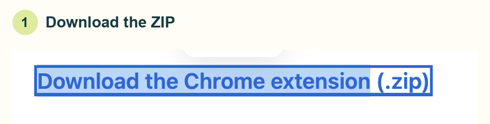
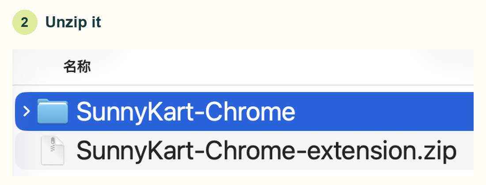
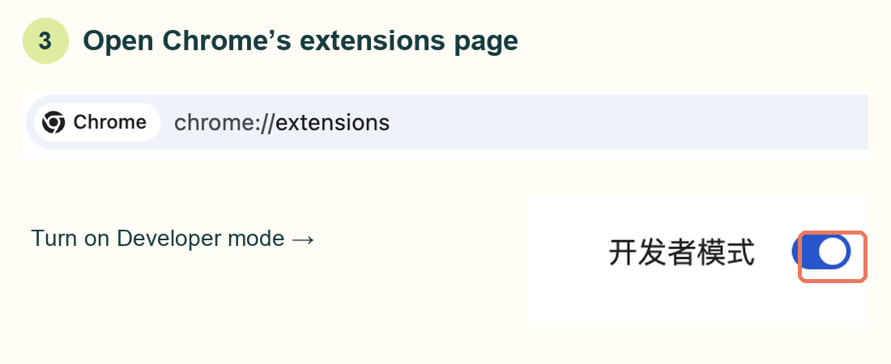
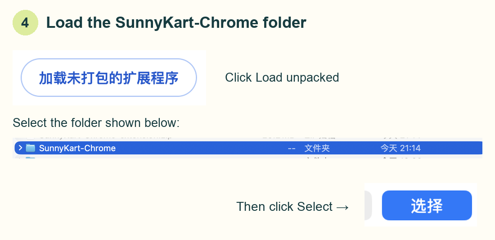
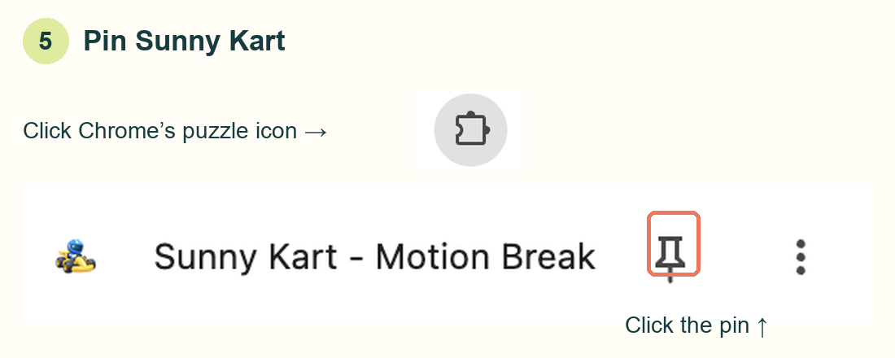
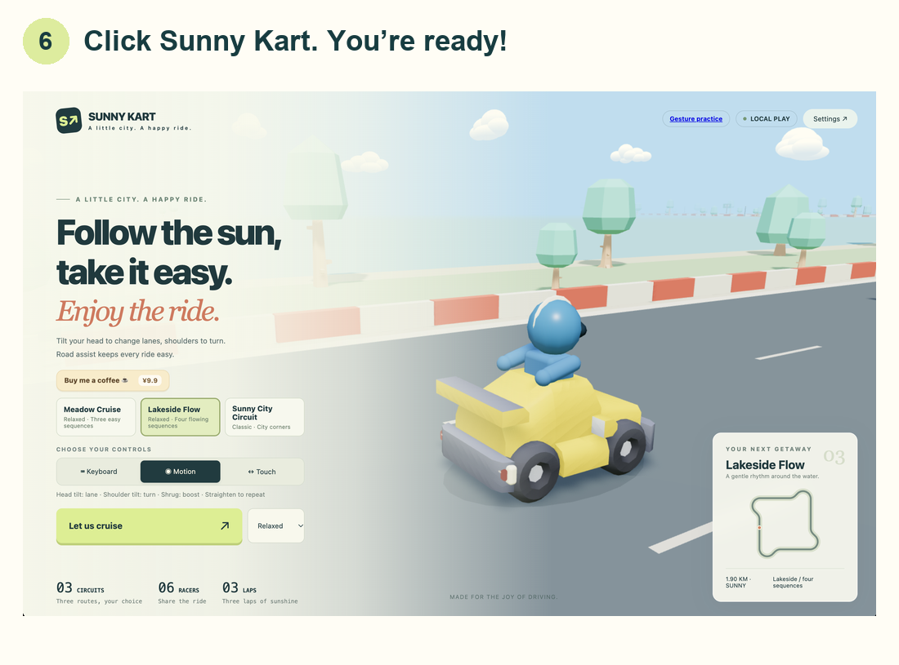

# Sunny Kart — Manual Chrome Installation

**[Download the Chrome extension (.zip)](https://github.com/X-mOtion/sunny-kart-motion-break/releases/latest/download/SunnyKart-Chrome-extension.zip)** · [中文图文教程](INSTALL.manual.zh-CN.md)

Follow these six steps. No commands to type.

### 1. Download

Click the download link above.

### 2. Unzip

On Mac, double-click the ZIP. You will get a **SunnyKart-Chrome** folder. On Windows, right-click the ZIP and choose **Extract All**.

### 3. Open the extensions page

Type **chrome://extensions** in Chrome’s address bar. Turn on **Developer mode** in the top-right corner.

### 4. Load the folder

Click **Load unpacked**, select **SunnyKart-Chrome**, then click **Select**. Choose the folder, not the ZIP.

### 5. Pin the game

Click Chrome’s **puzzle icon**, then the **pin** next to **Sunny Kart - Motion Break**.

### 6. Open Sunny Kart

Click the **Sunny Kart** icon in the toolbar. The game opens in a new tab.

**Done!** Click **Let us cruise** and allow your camera to play in Motion mode.

Keep the extracted folder after installation. These screenshots show Chrome on a Mac; button text follows your browser’s language.
